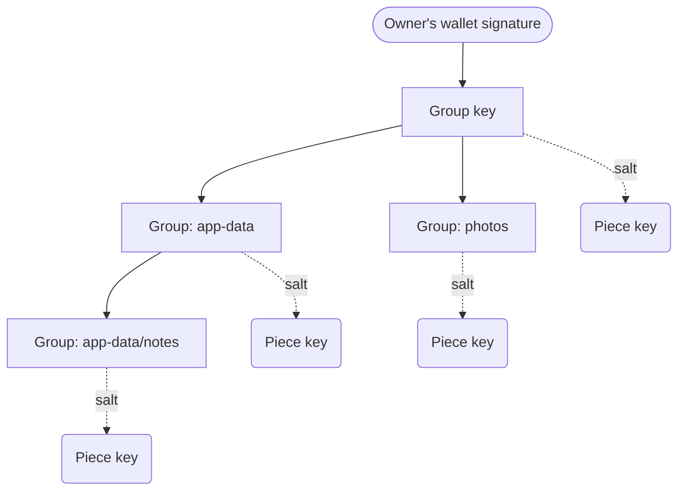

:::note[Jump straight in]
This page covers the details of how keys are managed and used. If you want to jump straight into it, start with [Encrypt a file](/developer-guides/encryption/encrypt-a-file/) for the complete storage example.
:::

## Keysmith and FEE

The [Keysmith package](/reference/filoz/keysmith/toc/) takes the hard work out of encryption key management for files stored on Filecoin. No matter where you access your data from, or how far in the future, or if you forget all your application passwords...only your wallet is required to recover everything.

Three packages share the work:

| Package | Role |
| --- | --- |
| [`filecoin-encryption-envelope`](https://github.com/FilOzone/synapse-sdk/tree/master/packages/filecoin-encryption-envelope) (FEE) | The encrypted format: an envelope header, then the ciphertext. Supports streams and range reads |
| [`@filoz/keysmith`](https://github.com/FilOzone/synapse-sdk/tree/master/packages/keysmith) | The keys: derives every encryption key from one wallet signature, and enables fine-grained sharing |
| [`@filoz/synapse-sdk`](/developer-guides/synapse/) | Storage: uploads the encrypted bytes, unchanged |

Simply:

```text
your app ──▶ Keysmith ──key──▶ FEE ──encrypted bytes──▶ Synapse SDK ──▶ storage providers
```

## A tree of keys

Keysmith derives encryption keys for data as a tree, starting with the wallet (which can always see everything) and then allowing application-defined tightening of access to smaller groups until you reach the individual piece key.



The concepts that enable this are:

* A **group key** is the secret root of a tree of encryption keys, named by a **group key id**: 16 random bytes the application chooses, which are public. Keysmith derives the group key from the owner's wallet signature. Every key in the tree is derived from it, enabling full recovery from just another wallet operation. The application can choose to have one or many group keys depending on the need for hard cryptographic separation.
* **Encryption groups** collect pieces within a group key, enabling fine-grained separation of key access. Groups can contain other groups: a holder of `app-data` can derive keys for `app-data/notes`, but a holder of `app-data/notes` cannot derive keys for its parent or sibling groups.
* Each **piece** gets its own key, derived from its group key (and optional group) and a random salt. The salt is saved in the FEE metadata so that the piece can always be recovered by a suitably authorized client.

⚠️ Keysmith derives a **symmetric** hierarchy of keys from the root signature: this has significant benefits, but also some things to watch out for:

* ✅ No need for a centralized auth server: everything stays on the client and is truly point to point.
* ✅ No need to re-encrypt files or update any kind of stored list when sharing with new parties
* ✅ Nothing to lose: as long as you still have your wallet you can get everything back
* ⚠️ No true revocation: once you've given someone a symmetric key they effectively have encrypt/decrypt capability forever.
* ⚠️ No true expiry: for the same reason as above. Manage groups carefully, and only share as little of the group key as needed for the use case (potentially just single pieces).

For deeper details on limits and lifecycle, refer to the [Keysmith README](https://github.com/FilOzone/synapse-sdk/tree/master/packages/keysmith).

```ts twoslash
// @lib: esnext,dom
import * as Keysmith from '@filoz/keysmith'
import { privateKeyToAccount } from 'viem/accounts'

const account = privateKeyToAccount('0x...')
// ---cut---
// The owner's wallet signs to derive the group key's root key.
const ref = { owner: account.address, groupKeyId: Keysmith.newGroupKeyId() }
const { kk: groupKey } = await Keysmith.deriveGroupKey(account, ref)

// A group’s key derives from the group key, and nested groups from their parents.
const appData = Keysmith.keyForGroup(groupKey, 'app-data')
const notes = Keysmith.keyForGroup(appData, 'notes') 

// Or, a holder of the groupKey can derive nested groups in one shot
// const notes = Keysmith.keyForGroup(groupKey, 'app-data/notes')

// Each piece gets its own key, from a fresh salt.
const salt = Keysmith.newSalt()
const key = Keysmith.pieceKey(notes, salt)
```

## Fine-tuning access to encryption keys

**Groups** are the intermediate nodes on the tree of keys between the all powerful
root group key and single piece keys. They allow delegation of *a portion of*
the entire group key to non-owner actors, processes, or agents. A group’s key is derived
from its parent’s key, so **holding a group means you can access all data and sub-groups
beneath it, but nothing above or beside it**, allowing apps/users to limit
access to different session keys/apps.

Just like scopes in other security protocols they are highly flexible and
user/application-defined, and can model metaphors like ‘subfolders’, or ‘roles’,
or ‘security classification’. Any of these metaphors (and more!) work, but it
would be very dangerous to try to mix them! So pick the one that works best for
your application and stick with it consistently.

The **group** is a user/application-chosen access label (string) such as
`agent-memory` or `super-secret`. Keysmith is unopinionated about how groups
are used, or what’s in them, other than the `/` separator. The `/` allows
specification of sub-groups and finer divisions. Because we’re dealing with
strings and need deterministic encoding each segment must be well-formed Unicode
(no lone surrogates), case-sensitive, non-empty, unpadded and without `/`.

Examples:

* **Clearance levels/MLS**: `top-secret` contains `top-secret/secret`, which contains
`top-secret/secret/official`. A holder of `top-secret/secret` can grant an agent
access to `top-secret/secret/official` and they can happily operate in that
`official` layer without being able to walk back up the tree.
* **Naive RBAC roles**: `super-admin` contains `super-admin/admin`, which contains
`super-admin/admin/user`. A holder of `super-admin` can grant a session key access
to `super-admin/admin` and they can happily manage `users` without being able to
walk back up the tree.
* **Separate trees**: `agents`, `teams/a-team`, `teams/tiger-team`. Holders of `agents` are
disjoint from the other groups. A holder of `teams` can see and delegate the data
of every team, while holders of `teams/a-team` and `teams/tiger-team` are kept
separate and cannot read or write each other's data.

By convention, `filecoin-pin` and the Filecoin Pay Console use this separate-trees model.

This may look counter-intuitive, starting at most privileged and walking outward,
or specifying the whole `top-secret/secret/official` rather than just `official`,
but this enables verifiers to walk the entire path to look at and verify
where the grant came from (all the way back to the root). The actual node key
shared is only the last element of the path. So you can **verify up**, but only
**derive and decrypt** down.

## Recovery metadata

Nothing is required from the chain or any secrets store to recover keys and data: the application only needs the group key id metadata when *writing* data, and the piece's FEE metadata when *reading*.

| Location | What it records | Purpose |
| --- | --- | --- |
| Each piece's envelope | Owner, group key id, group, and salt | Identify the key needed to decrypt that piece. |
| Data set metadata | Group key id and commitment | Identify the derivation tree that the piece's key lives in. |

Synapse SDK does not derive or add these automatically so the application needs to do this. Generate the FEE metadata entries with [`pieceMetadata()`](/reference/filoz/keysmith/functions/piecemetadata/), and pass the data set entries explicitly through the SDK's `metadata` option.

```ts twoslash
// @lib: esnext,dom
import * as Keysmith from '@filoz/keysmith'
import { Synapse } from '@filoz/synapse-sdk'
import { privateKeyToAccount } from 'viem/accounts'

const account = privateKeyToAccount('0x...')
const synapse = Synapse.create({ account, source: 'my-app' })
const ref = { owner: account.address, groupKeyId: Keysmith.newGroupKeyId() }
declare const encrypted: Uint8Array
// ---cut---
const { kk: groupKey, commitment, descriptor } = await Keysmith.deriveGroupKey(account, ref)

// Envelope entries: pass these to FEE as appMetadata when encrypting the piece.
const target = Keysmith.writeTarget(descriptor, groupKey, 'app-data/notes')
const salt = Keysmith.newSalt()
const appMetadata = Keysmith.pieceMetadata(target.ref, { salt, group: target.group })

// Data set entries: pass these to the SDK when uploading.
const metadata = {
  [Keysmith.GROUP_KEY_ID_KEY]: ref.groupKeyId,
  [Keysmith.COMMITMENT_KEY]: commitment,
}
await synapse.storage.upload(encrypted, { metadata })
```

The FEE envelope lives with the encrypted piece and identifies all that is needed to decrypt it. Group names, owner addresses, and salts are all stored in clear and visible to anyone. *Do not put secrets in these fields*.

## Recover keys

:::warning[Avoid over-exposure of the wallet]
By rooting the derivation tree in the owner wallet, data protected by Keysmith are extremely resilient and recoverable. However this does mean that abuse of the wallet key could lead to compromise of the secrets.

As with any crypto wallet operation, only approve key-derivation requests in applications you trust, and always read the sign message carefully.
:::

To recover a key for a piece you have found, read the group key id from the piece's envelope and check that its owner matches the account you expect, then call [`deriveGroupKey()`](/reference/filoz/keysmith/functions/derivegroupkey/) with that group key id and owner.

The data set metadata is optional. If you've lost it, or it records a different group key id, recovery still works without the commitment: Keysmith asks the wallet to sign twice instead of once.

Pass the recovered key to [`keyResolver()`](/reference/filoz/keysmith/functions/keyresolver/) when decrypting. Keysmith derives the piece key entirely from that piece's metadata, so everything you need to recover the data is self-contained.

```ts twoslash
// @lib: esnext,dom
import * as Keysmith from '@filoz/keysmith'
import * as fee from 'filecoin-encryption-envelope'
import { privateKeyToAccount } from 'viem/accounts'

const account = privateKeyToAccount('0x...') // Or use your wallet
declare const downloaded: Uint8Array
declare const dataSetMetadata: Record<string, string> | undefined // Optional, if you still have it

// ---cut---
// The envelope names the group key id and its owner.
const { appMetadata } = await fee.parse(downloaded)
const envelope = appMetadata as Keysmith.PieceMetadata
if (envelope['foc/own'] !== account.address.toLowerCase()) {
  throw new Error('This piece belongs to another owner')
}
const ref = { owner: account.address, groupKeyId: envelope['foc/ks'] }

// Use the data set's commitment only if it records the same group key id.
// Without it, recovery still works: the wallet just needs to sign twice.
const commitment = dataSetMetadata?.[Keysmith.GROUP_KEY_ID_KEY] === ref.groupKeyId
  ? dataSetMetadata[Keysmith.COMMITMENT_KEY]
  : undefined
const { kk: groupKey } = await Keysmith.deriveGroupKey(account, ref, { commitment })

// Now we have the key, pipe this piece, or any other in the group key, through this to decrypt it.
const decryptor = fee.decrypt(Keysmith.keyResolver(groupKey))
```

### Protect a group key with a password

By default, the wallet's signature alone derives the group key, so anyone who tricks the owner into signing that one message can derive it too. To prevent that, pass a `password` to `deriveGroupKey()`: the key then depends on both the signature and the password. Keysmith stretches the password with Argon2id, which takes about a second and 64 MiB of memory.

The cost is recovery: **if the password is lost, the group key and everything under it are lost**, and nothing can bring them back.

- **When creating a group key,** ask the user to type the password twice and compare. Keysmith has nothing to check it against yet, so a typo would silently create the group key under the typo.
- **When reopening a group key,** pass both `password` and the recorded `commitment`. Only the commitment can tell a wrong password from a right one: without it, a wrong password silently derives a different key that decrypts nothing.
- An empty password, or one that isn't well-formed Unicode, is refused before the wallet prompts. Passwords are compared in Unicode NFC form, so the same text typed on different keyboards matches.

```ts twoslash
// @lib: esnext,dom
import * as Keysmith from '@filoz/keysmith'
import { privateKeyToAccount } from 'viem/accounts'

const account = privateKeyToAccount('0x...')
declare const password: string // Confirmed by the user when the group key was created
declare const commitment: string // From the data set's Keysmith.COMMITMENT_KEY
declare const groupKeyId: `0x${string}`
// ---cut---
const ref = { owner: account.address, groupKeyId }
const { kk: groupKey } = await Keysmith.deriveGroupKey(account, ref, { password, commitment })
```
